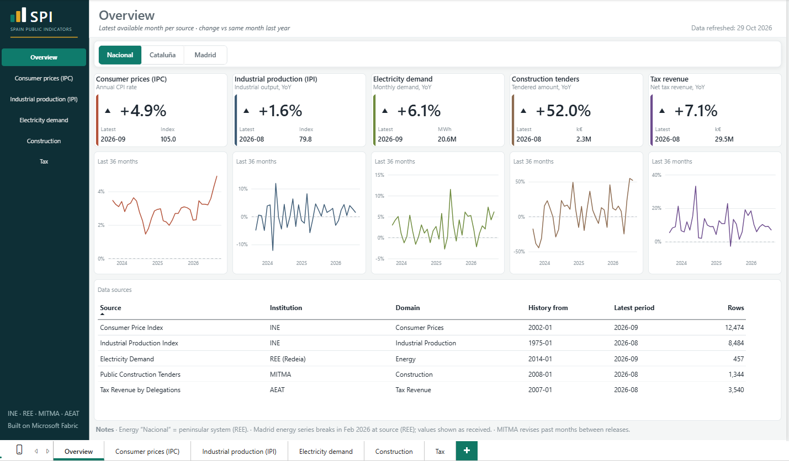
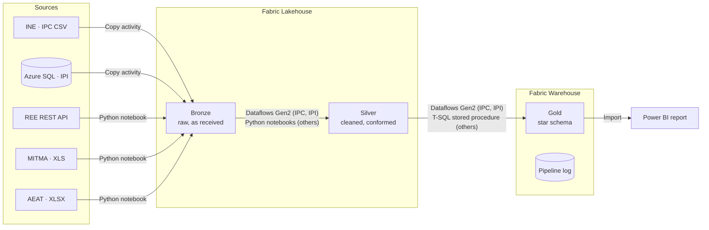
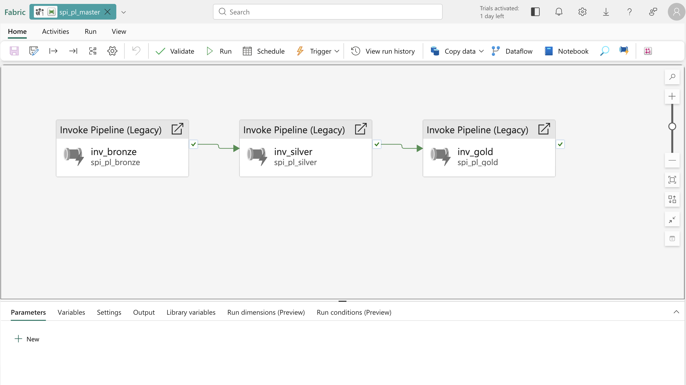
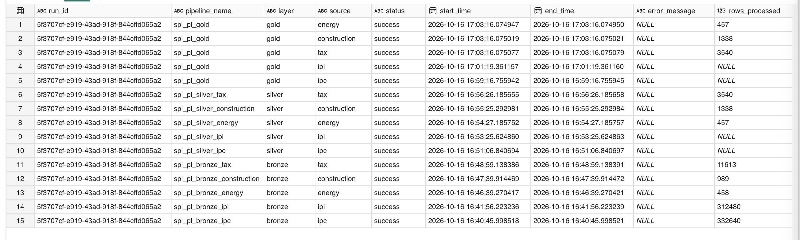
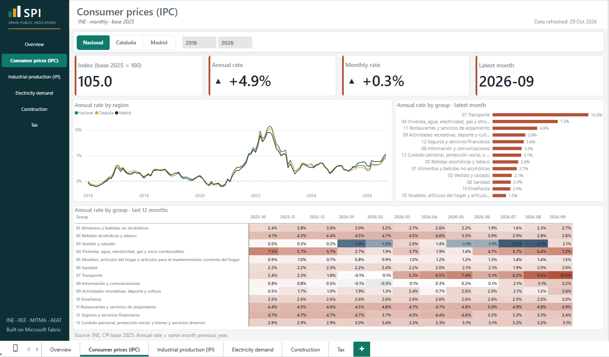
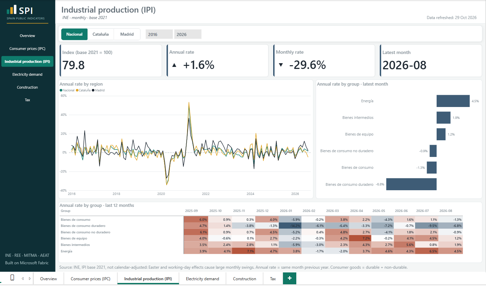
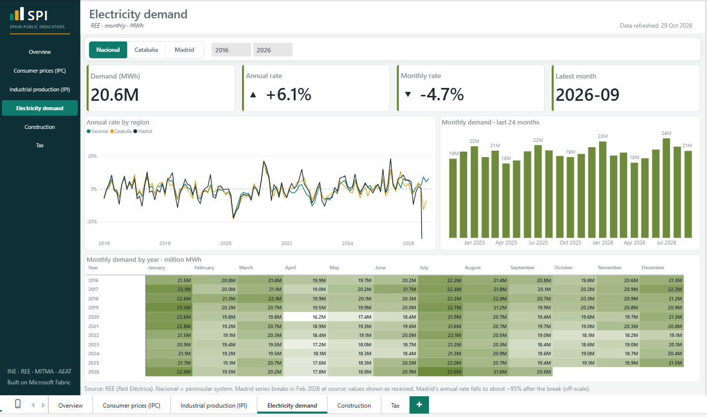
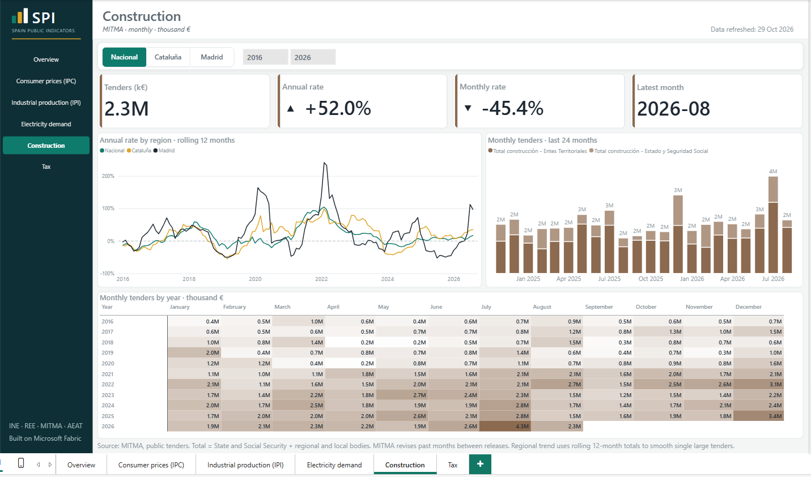
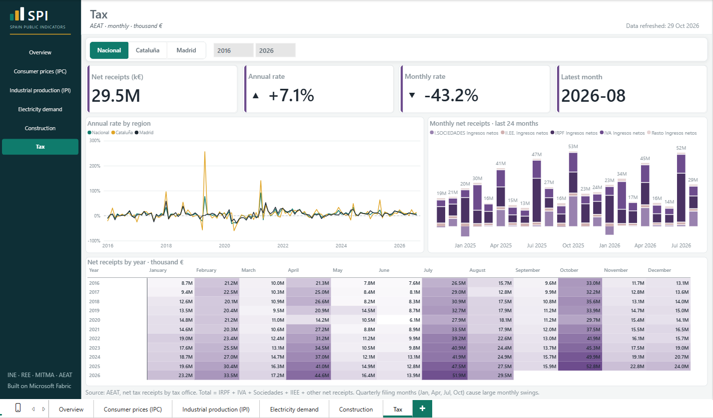

# SPI — Spain Public Indicators

**An end-to-end analytics platform on Microsoft Fabric.** Five Spanish public
data sources in five different formats, one medallion architecture, one
orchestrated run, one Power BI report.

Built as a client-grade portfolio project: requirements, architecture,
functional and technical specifications, implementation, validation and a
documented trail of every design decision.



---

## What it does

SPI ingests monthly economic indicators for **Spain (national), Catalonia and
Madrid**, cleans them into a common shape, and publishes them as a star schema
for reporting.

| # | Indicator | Publisher | Source format | Ingestion | History |
|---|---|---|---|---|---|
| 1 | Consumer prices (CPI, Spanish *IPC*) | INE | CSV over HTTP | Pipeline Copy activity | 2002– |
| 2 | Industrial production (IPI) | INE | Azure SQL (simulated transactional source) | Pipeline Copy activity | 1975– |
| 3 | Electricity demand | REE (Redeia) | REST API, nested JSON | Python notebook | 2014– |
| 4 | Public construction tenders | MITMA | 4 legacy XLS files, image-only headers | Python notebook | 2008– |
| 5 | Tax receipts | AEAT | Multi-sheet XLSX | Python notebook | 2007– |

Each source was chosen for a different ingestion problem, so each Fabric
component is used where it fits, not forced.

## Architecture



**Orchestration.** `spi_pl_master` runs `spi_pl_bronze` → `spi_pl_silver` →
`spi_pl_gold`. The Bronze and Silver pipelines invoke one pipeline per source;
the Gold pipeline runs the IPC/IPI dataflows and the stored procedure directly.
Every step logs to a Warehouse table under a single `run_id`, and each layer
ends with a **gate**: a check of that log. If any source failed, the layer
fails and the master stops before the next layer.

**Gold.** A star schema in the Warehouse: one fact table
(`spi_fact_indicators`) and four dimensions (indicator, region, calendar,
source). Fact loads are idempotent (delete-by-source, then insert), so any run
can be repeated safely.

## Stack

| Component | Used for | Why there |
|---|---|---|
| Data Pipelines | Copy activities, orchestration, logging, gates | Native scheduling and dependency control |
| Notebooks (Python runtime) | REST API and spreadsheet parsing | Messy formats need code; the Python runtime avoids Spark start-up cost on small data |
| Dataflows Gen2 | IPC and IPI Silver and Gold | Low-code transformations on tidy, well-structured sources |
| Lakehouse (Delta) | Bronze and Silver | Files and tables in one place |
| Warehouse (T-SQL) | Gold star schema, stored procedure, log table | Relational model, SQL validation |
| Power BI (PBIP, Import) | 6-page report | Version-controlled model and report; viewing needs no Pro licence. Refreshing needs the Fabric Warehouse |

## Results

**Validated after each master run** with six SQL checks
([`spi_validation_checks.sql`](03-src/warehouse/spi_validation_checks.sql)):
fact rows = Silver rows for every source, no duplicate fact keys, no orphan
calendar, indicator or region keys, and a complete calendar (1975 to the
current year).

| Source | Gold rows (29 Oct 2026) |
|---|---|
| IPC | 12,474 |
| IPI | 8,484 |
| Energy | 457 |
| Construction | 1,344 |
| Tax | 3,540 |

Row counts grow as publishers release new months.

**Checked against the publisher.** The report's annual CPI rate matches INE's
official figure for every month of 2026 (ADR-003, addendum 2026-10-17).

**Reproducible.** On 21 Oct 2026 the whole workspace was **rebuilt from this
repository** (reusing only the tenant connections and the Azure SQL source), on
a new F2 capacity in another Azure region, in about **2.5 hours**. The first
end-to-end run succeeded, and the row counts and validation checks matched the
original workspace. See the [rebuild checklist](01-docs/rebuild_checklist.md)
and the [ID map](01-docs/rebuild_id_map.md).

| Run evidence | |
|---|---|
|  |  |

## The report

Six pages: an overview plus one detail page per source. Region and period
slicers are synced across pages.

| | |
|---|---|
|  |  |
|  |  |
|  | |

Design choices worth noting:

- **Index sources are never summed.** A single `Value` measure averages index
  series (IPC, IPI) and sums additive flow series (energy, tenders, tax). It
  returns blank rather than mixing regions, sources or different indices.
- **Lumpy data gets a smoother metric.** Construction tenders use a rolling
  12-month annual rate, because one large tender can swing a single month by
  several hundred percent.
- **Source anomalies are shown, not hidden.** Footnotes explain them (see
  below).

## Data notes

Data is kept **as published**. Known issues are documented, not corrected:

- **Energy "Nacional"** is the peninsular system (REE does not publish national
  demand for this series).
- **Madrid electricity demand** drops about 25× from February 2026 at source.
  The cause is unknown; the values are kept as received (ADR-015).
- **IPI** is not calendar-adjusted, so Easter and August cause large monthly
  swings.
- **MITMA revises past months** between releases.
- **Tax by region** is what each regional AEAT office collects. Large
  companies are collected centrally and appear only in the national figure
  (ADR-017).

## Engineering decisions

Every decision and every deviation from the original specification is recorded
in [`01-docs/spi_adr_log.md`](01-docs/spi_adr_log.md), with context,
alternatives and consequences. A few examples:

| ADR | Decision |
|---|---|
| 009 | Logging: one log table in the Warehouse, one `run_id` per master run |
| 010 | Gold load: seeded dimensions with explicit keys, delete-by-source then append |
| 012 | Notebooks on the Fabric Python runtime, not Spark |
| 014 | Gold for three sources as a T-SQL stored procedure, not a notebook |
| 015 | Silver publishes complete periods only; source anomalies kept as received |
| 018 | Bronze and Silver pipelines invoke per-source pipelines; layer gates stop the master |
| 019 | Paid capacity in Sweden Central after the trial |
| 020 | Power BI in Import mode, not Direct Lake |

A *gate* is a pipeline check that stops a run when a layer failed. *F2* is the
smallest paid Fabric capacity. *Direct Lake* is a Power BI mode that reads the
Lakehouse directly; this project uses Import instead (ADR-020).

Platform findings (Fabric quirks, T-SQL limits, notebook behaviour) are in
[`01-docs/lessons-learned.md`](01-docs/lessons-learned.md).

## Repository

```
01-docs/            Phase documents (PDF), ADR log, dev plan, lessons learned,
                    rebuild checklist, run evidence
02-prerequisites/   One-time local scripts: Azure SQL bootstrap, extraction baselines
03-src/
  pipelines/        14 Fabric pipelines (JSON)
  notebooks/        7 notebooks: bronze/, silver/, gold/
  dataflows/        Dataflows Gen2 (Power Query M) and their destinations
  warehouse/        DDL, stored procedure, validation checks
  power-bi/         Power BI project (PBIP), theme and backgrounds
```

## Documentation

| Document | Content |
|---|---|
| [Project brief](01-docs/phase0_project_brief.pdf) | Context, scope, strategy |
| [Requirements](01-docs/phase1_requirements.pdf) | Requirements and source catalogue |
| [Architecture](01-docs/phase2_architecture.pdf) | Architecture and data flow |
| [Functional spec](01-docs/phase3_functional.pdf) | What the system does, per source |
| [Technical spec](01-docs/phase4_technical.pdf) | How it is built |
| [Development plan](01-docs/phase5_dev_plan.md) | Sprints, status, risks |

The phase documents are frozen. Where the implementation differs, the ADR log
records why.
The living documents (ADR log, development plan, rebuild checklist) are kept as
they were written during the project, open items included, to show the process.

## Limitations

- **One workspace** (ADR-011): no separate test or production environment yet.
- **Manual operations:** runs, validation checks and the report refresh are
  started by hand; the capacity is paused between runs to control cost.
- **IPI** is shown as published, not calendar-adjusted.

## Roadmap

- **Git integration and a deployment pipeline** (dev → prod) with deployment
  rules for connections and item bindings.
- **Scheduled refresh** of `spi_pl_master` after each publisher's release
  calendar.
- **Calendar-adjusted IPI** as a second series.

## Running it

The platform needs a Fabric capacity (F2 is enough, ADR-019) and an Azure SQL
database for the IPI source. The [rebuild checklist](01-docs/rebuild_checklist.md)
lists every item to create and every ID to replace;
[`02-prerequisites/`](02-prerequisites/) loads the Azure SQL source.

## How it was built

Built solo, May–October 2026, in about 300 hours of evening work alongside a
full-time job. I made every design decision and recorded it in the ADR log;
Claude Code was used as an implementation assistant under those decisions.

## Author

**Gastón Baloira**, data and analytics engineer (Microsoft Fabric, Power BI,
Azure, SQL Server, Python).

[LinkedIn](https://www.linkedin.com/in/gastonbaloira/)

## License

Code: [MIT](LICENSE). Documentation: [CC BY 4.0](https://creativecommons.org/licenses/by/4.0/).
Source data © INE, REE, MITMA and AEAT, used under their public reuse terms.
